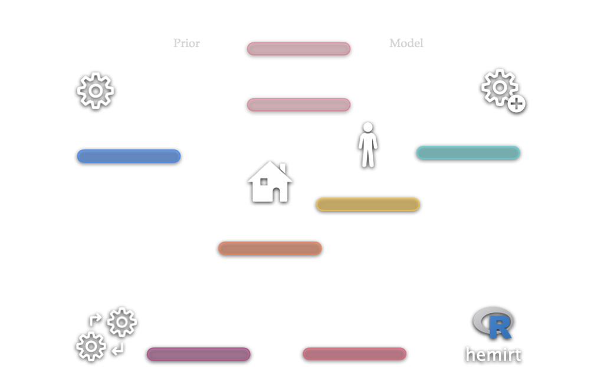

# *hemirt* : Package Tutorial

The purpose of this tutorial is to present *hemirt* ("Household Epidemiological Modeling for Inference Rcpp Toolkit") for the study of epidemiological data from household outbreaks.



## Necessary Definitions

The package requires three main input files to build the model:

1.  **database.csv :** : this file contains individual indexes, infection statuses and house index (necessary columns), plus all needed additional columns.

    |           |            |                 |         |         |
    |-----------|------------|-----------------|---------|---------|
    | **index** | **status** | **house_index** | **sex** | **age** |
    | 0         | 1          | 101             | 0       | 59      |
    | 1         | 0          | 101             | 1       | 61      |
    | 2         | 1          | 102             | 0       | 65      |
    | ...       |            |                 |         |         |

2.  **parameters.csv :** this file includes the initial parameters and priors needed for the Bayesian inference process.

    | name  | value | infer | prior   | pargs       | strategy | sargs             | range       |
    |-------|-------|-------|---------|-------------|----------|-------------------|-------------|
    | alpha | 1     | true  | uniform | min/0/max/1 | lognorm  | meanlog/0/sdlog/1 | min/0/max/1 |
    | ...   |       |       |         |             |          |                   |             |

3.  **setup.csv :** this file holds the model setup configurations such as the number of iterations, thinning, seed, etc.

## Installation and Loading

We'll walk through the process of loading the model, building it with necessary data and running inference. First, let's install and load the local package. *Important!* The tutorial assumes that your working directory is the path of the package source code.

```{r}

suppressPackageStartupMessages(library("tidyverse"))

# load the 'hemirt' package into this R session
devtools::load_all()

```

Next, we create an object using the function `generate_model` to initialize the core model used for the inference. We use the default model *chain_binomial*.

```{r}

model_file <- "models/chain_binomial/model.cpp"

# Create a model object using the 'generate_model' function
# this can take a few minutes...
hemi <- generate_model(model_file, force = TRUE, quiet = TRUE)

```

**Note:** the generation is taking so long because it's recompiling all files. I am looking for a way to compile these files just at the installation.

We associate necessary files to our model object using the `build_model` function:

```{r}

# Build the model by associating it with necessary input files
build_model(
  hemi,
  data = "example/database.csv",
  params = "example/parameters.csv",
  setup = "example/setup.csv",
  verbose = TRUE
)

```

Try to change setup and parameter from the files.

**Note:** openMP is unsupported on macOS without a custom compiler, thus the option `num_threads` could stay inactive.

## Simulation

To run the model and perform inference, we execute the function 'run_hemirt_infer'. This method will return a 'coda' object which can then be used to analyze the results.

```{r}

# Run inference on the model and obtain results as a coda mcmc object
synth <- run_hemirt_simulate(hemi)
head(synth)

```

The inference process returns the Watanabe-Akaike Information Criterion *WAIC*.

## Inference

To run the model and perform inference, we execute the function 'run_hemirt_infer'. This method will return a 'coda' object which can then be used to analyze the results.

```{r}

# Run inference on the model and obtain results as a coda mcmc object
mcmc <- run_hemirt_infer(hemi)

# Set a burnin
mcmc <- window(mcmc, start=1000)

```

The inference process returns the Watanabe-Akaike Information Criterion *WAIC*.

```{r}

# Print summary of the posterior estimates
results <- summary(mcmc) %>%
  { 
    stats <- .$statistics %>%
      as.data.frame() %>%
      select(Mean, SD) %>%
      rownames_to_column("name")
    quant <- .$quantiles %>%
      as.data.frame() %>%
      select(`2.5%`, `97.5%`) %>%
      rownames_to_column("name")
    full_join(stats, quant, by = "name")
  }
results

# Trace plots for visualizing the MCMC chains
coda::traceplot(mcmc)

```

## Custom models

To test a custom model you can start by copying a subfolder within *models* to a custom path. Modify all relevant parts of the C++ implementation file *user_model.cpp* and of the header file *user_model.h* which are meant to remain in the same path. You can re-run this tutorial simply changing `model_file`.

**Note:** to avoid errors you should change only the chunks of code indicated with *CHANGE-ME*.
