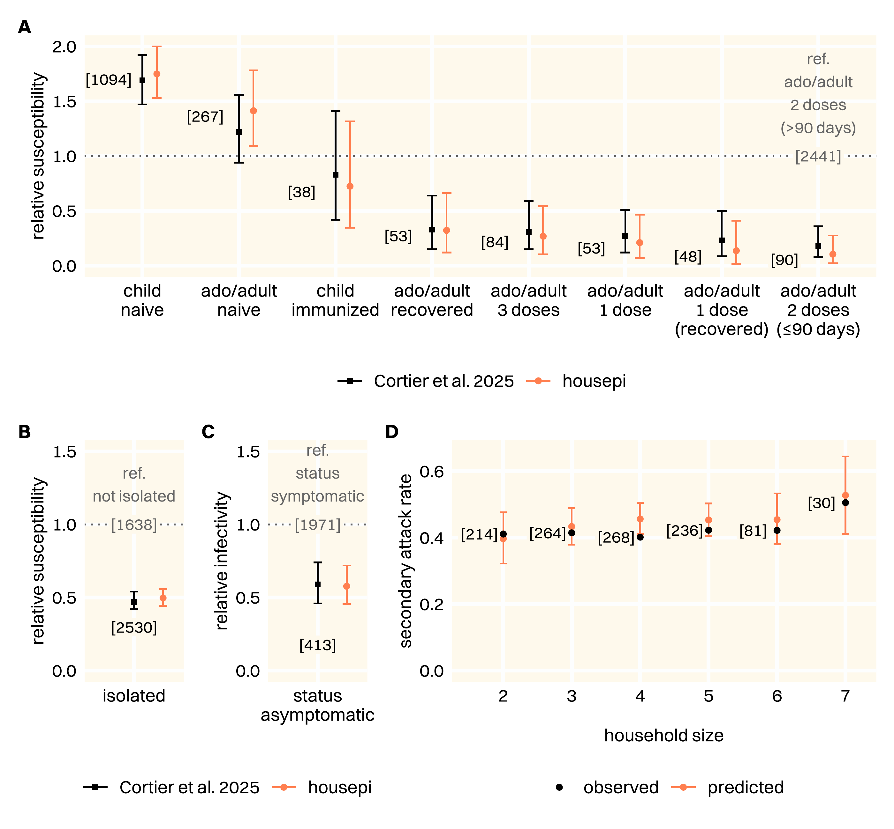

Analyses of household studies run with housepi.
Each analysis is archived in its own repository and might have been run with a different version of housepi.

## Introducing housepi

<figure>

<figcaption>
ICoFS case-ascertained study, SARS-CoV-2 2021:
relative susceptibility and infectivity estimated by housepi against @cortier_factors_2025,
and posterior predicitive checks on secondary attack rates.
</figcaption>
</figure>

Pre-print: @camaglia_seamless_2026.

Three household studies reanalysed with housepi, one vignette each:

- [Influenza in Matsumoto households, 2014/15](https://mmmi-pasteur.pages.pasteur.fr/introduce-housepi/articles/matsumoto.html):
  a final-size model estimates the community transmission rate by member type and the contact rate between member types, following @endo_fine_scale_2019.
- [SARS-CoV-2 Delta in Israeli households, 2021](https://mmmi-pasteur.pages.pasteur.fr/introduce-housepi/articles/icofs.html):
  a case-ascertained continuous-time model estimates susceptibility by immune status and isolation, and infectivity by symptom status, augmenting the infection times, following @cortier_factors_2025.
- [SARS-CoV-2 Delta in Israeli households, 2021, in discrete time](https://mmmi-pasteur.pages.pasteur.fr/introduce-housepi/articles/icofs_discrete.html):
  the discrete-time version of the same model.

External links:
- site: <https://mmmi-pasteur.pages.pasteur.fr/introduce-housepi/>.
- code: <https://gitlab.pasteur.fr/mmmi-pasteur/introduce-housepi>.

## References
