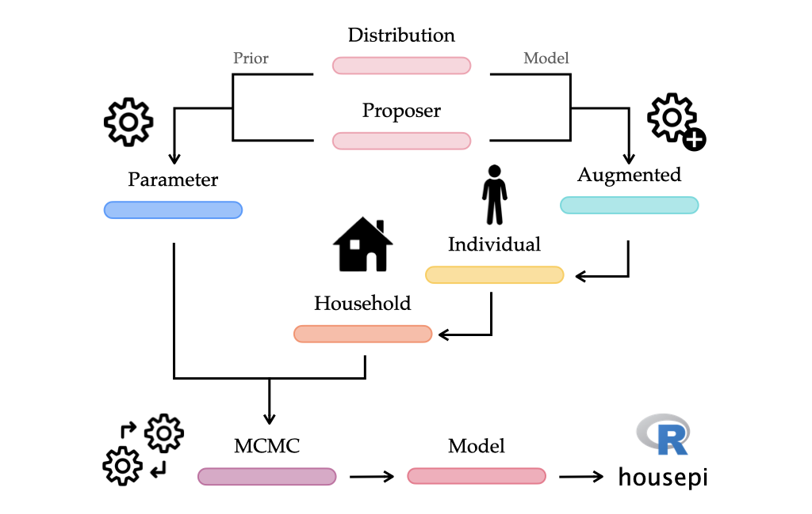

# *housepi* : Package Tutorial

The purpose of this tutorial is to present *housepi* ("Household Epidemiological Modeling for Inference Rcpp Toolkit") for the study of epidemiological data from household outbreaks. 
We'll walk through the process of loading the model, building it with necessary data and running inference. 

```{r, echo=FALSE, out.width = "100%"}

```

## Necessary Definitions

The package requires three main input files to build the model:

1.  **database.csv :** : this file contains the individual index, infection status and house index (necessary columns), plus all needed additional columns without any particular order.

    |           |            |                 |         |         |
    |-----------|------------|-----------------|---------|---------|
    | **index** | **status** | **house_index** | **age** | **sex** |
    | 1         | 1          | 1               | 55      | 1       |
    | 2         | 1          | 1               | 60      | 2       |
    | 3         | 0          | 2               | 21      | 1       |
    | ...       |            |                 |         |         |

2.  **parameters.csv :** this file includes the initial parameters and priors needed for the Bayesian inference process.

    | name  | value | infer | prior   | pargs       | strategy | sargs             | range       |
    |---------|---------|---------|---------|---------|---------|---------|---------|
    | alpha | 1     | true  | uniform | min/0/max/1 | lognorm  | meanlog/0/sdlog/1 | min/0/max/1 |
    | beta  | 1     | true  | uniform | min/0/max/1 | lognorm  | meanlog/0/sdlog/1 | min/0/max/1 |
    | ...   |       |       |         |             |          |                   |             |

3.  **setup.csv :** this file holds the model setup configurations such as the number of iterations, thinning, seed, etc.

    |                      |            |
    |----------------------|------------|
    | **seed**             | 576125013  |
    | **num_iter**         | 10000      |
    | **num_adapt_iter**   | 1000       |
    | **rnd_init_params**  | TRUE       |
    | **num_threads**      | 4          |
    | ...                  |            |
    
    
**Note:** openMP is unsupported on macOS without a custom compiler, thus the option `num_threads` is temporary inactive because of portability issues.
    
## Installation

First, install the package.

## Model Generation

We can now create an object using the function `generate` to initialize the core model used for the inference. We use the default model *chain_binom*.

```{r}

# Generate a model
# this can take a few minutes...
hemi <- housepi::generate("chain_binom", 
                         force = TRUE, 
                         quiet = TRUE)

```

**Note:** the generation is taking so long because it's recompiling all files. I am looking for a way to compile these files just at the installation.

We associate necessary files to our model object using the `build` function:

```{r}

# Build the model by associating it with necessary input files
housepi::build(
  hemi,
  data = "data/database.csv",
  params = "data/params.csv",
  setup = "data/setup.csv",
  verbose = FALSE
)

# show the selected parameter options 
hemi$params()

```

You can control the setup and parameter definitions from the files.

## Simulation

To simulate a dataset according to the model we execute the function `simulate`.

```{r}

# Run simulation to produce a synthetic dataset
simulated <- housepi::simulate(hemi)

# save the simulated dataset 
write.csv(simulated, "simulated.csv")

# associate the simulated dataset to the model 
housepi::build(hemi, data = "simulated.csv")

# show a summary of the new dataset
hemi$summary()

```

## Compute log-likelihood

Sometimes it can be useful to just compute the log-likelihood before trying to run the inference. You can do so by running the following:

```{r}

# compute the log-likelihood
housepi::compute_loglike(hemi)

```

## Inference

To run the model and perform inference, we execute the function `infer`. 
This method will return a 'coda' object which can then be used to analyze the results.

```{r}

# Run inference on the model and obtain results as a coda mcmc object
mcmc <- housepi::infer(hemi, progbar = FALSE)

# Set a burnin
mcmc <- window(mcmc, start=1000)

```

The inference process returns the Watanabe-Akaike Information Criterion *WAIC*.

```{r}

# Print summary of the posterior estimates
# Obtain the summary of the MCMC object
mcmc_summary <- summary(mcmc)

# Extract results from summary statistics
stats <- as.data.frame(mcmc_summary$statistics)[, c("Mean", "SD")]
stats$name <- rownames(stats)
quant <- as.data.frame(mcmc_summary$quantiles)[, c("2.5%", "97.5%")]
quant$name <- rownames(quant)
results <- merge(stats, quant, by = "name")
results <- results[, c("name", "Mean", "SD", "2.5%", "97.5%")]
results

# Trace plots for visualizing the MCMC chains
coda::traceplot(mcmc)

hemi$results()

```

## Custom models

To test a custom model you can start by copying a subfolder within *models* to a custom path. Modify all relevant parts of the C++ implementation file *user_model.cpp* and of the header file *user_model.h* which are meant to remain in the same path. You can re-run this tutorial simply changing `model_file`.

**Note:** to avoid errors you should change only the chunks of code indicated with *CHANGE-ME*.
