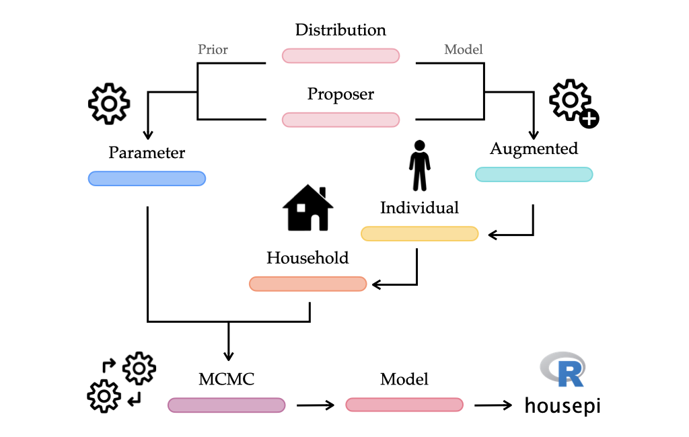

We introduce `housepi`, a toolkit for the study of epidemiological data from household outbreaks. We'll walk through the process of loading the model, building it with necessary data and running inference.

```{r, echo=FALSE, out.width = "100%"}

```

## Model Generation

We initialize our model objects with the function `generate_model`. We show how it works with the template chain binomial model:

```{r}
# generate a chain binomial model
hemi <- housepi::generate_model("chain_binom")
```

*Note:* this process can take a few minutes because it compiles the full template.

To see the list of template model names run `housepi::template_model()`. To create a custom model refer to the vignette [custom_models](custom_models.html).

## Build the Model

Every model requires its parameter definitions and a database.

1.  **parameters:** a DataFrame (or a csv file) with the parameters priors and proposer rules needed for the Bayesian Monte Carlo. Constants can be provided by putting the *infer* column to `FALSE`. To help formatting data frame with the respectful definitions, we provide a class `ParameterFrame` which can be used as follows:

```{r, echo=TRUE}
params <- housepi::ParameterFrame(list(
  alpha = list(x = 0.15, 
               prior = "unif", args = list(min = 0, max = 5),
               rule = "lnorm", rule_args = list(sdlog = 5)),
  beta = list(x = 0.25, 
              prior = "unif", args = list(min = 0, max = 5),
              rule = "lnorm", rule_args = list(sdlog = 5))
  ))
```

2.  **database:** a numerical DataFrame (or a csv file) with the individual data organised by rows. Individuals with equal `house_index` are associated to the same household. A column `status` must be provided if to perform inference, 0 if negative, 1 if positive, -1 if missing. Additionally, an `index` can be provided.

```{r, echo=FALSE}
knitr::kable(head(read.csv("survey.csv")))
```

We build our model with these information using the function `build_model`.

```{r}
# associate database and parameters
housepi::build_model(hemi, data = "survey.csv", params = params$df)
```

Additional definitions can be provided at any time by using the same function. E. g. we can pass the Monte Carlo general configurations with the argument:

-   **setup:** a list (or a csv file) with the number of iterations, seed, etc.

```{r}
setup <- list(num_iter = 5000, num_adapt = 1000, burn_in = 500,
              thinning = 10, num_chains = 4, rnd_init_params = TRUE,
              seed = 576125013, num_threads = 4)

# associate setup
housepi::build_model(hemi, setup = setup)
```

*Note:* openMP is not supported on latest macOS distributions, thus the option `num_threads` is non granted on such systems.

## Simulation

To produce a simulated database according to the model, we execute the command `run_simulation`. This requires a pre-loaded database to provide the household compositions.

```{r}
# override status of the database according to simulation 
housepi::run_simulation(hemi)

# show a summary of the current simulated database 
hemi$show_summary()
```

For the full results of the simulation, we can use the method `data` which returns the DataFrame with the current database.

```{r, eval=TRUE}
head(hemi$data())
```

## Inference

Before proceeding any further, it can be useful to check with the method `evaluate` if the model can evaluate the loglikelihood without errors:

```{r}
hemi$evaluate()
```

Now we can safely perform inference with the function `run_inference`.

```{r}
mcmc_traces <- housepi::run_inference(hemi)
```

This method returns a `coda` mcmc object (or mcmc.list) which can then be used to analyze the results as follows:

```{r}
# Visualize the traces of the first MCMC chain
coda::traceplot(mcmc_traces[1])

# Print summary of the posterior estimates
summary(mcmc_traces)

# Compute effective sample size
coda::effectiveSize(mcmc_traces)

# Gelman-Rubin diagnostic
coda::gelman.diag(mcmc_traces)
```

See [coda CRAN documentation](https://cran.r-project.org/web/packages/coda/index.html) for further details.

## Model Diagnostic

We can extract the log-likelihood matrix to perform model diagnostics with the R package `loo` ([CRAN documentation](https://cloud.r-project.org/web/packages/loo/index.html)) :

```{r}
llmtx <- hemi$loglike_matrix()

# WAIC (widely applicable information criterion)
loo::waic(llmtx)

# approximate LOO-CV
loo::loo(llmtx)
```

Another feature of the `housepi` package is the possibility to estimate the marginal loglikelihood with the method of the power posteriors:

```{r, eval=FALSE}
hemi$evaluate_marginal(30, TRUE, FALSE)
```
